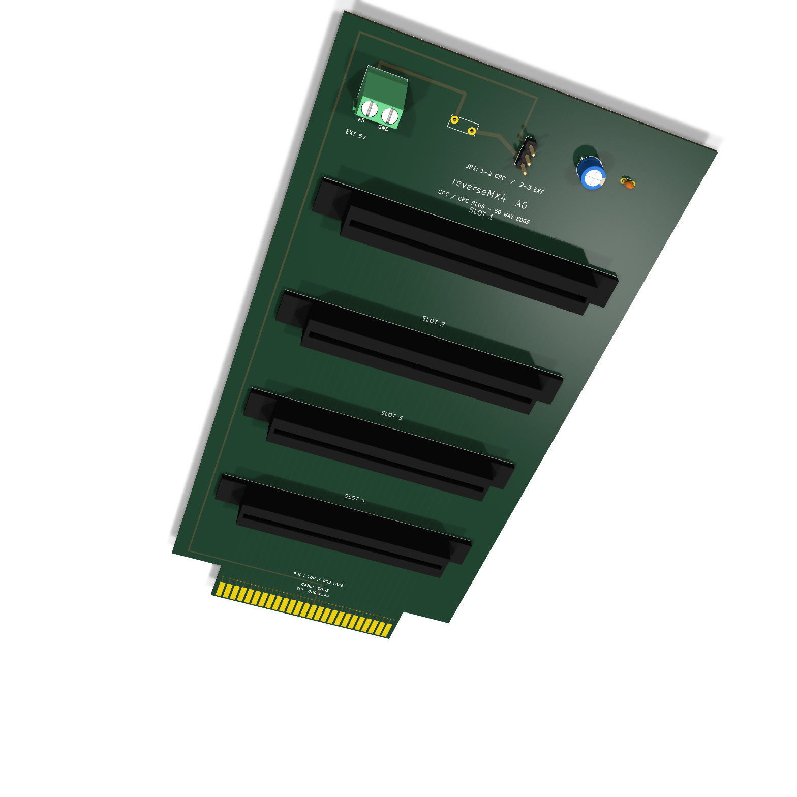

# reverseMX4: four-slot CPC edge backplane

This project is a four-slot expansion backplane for the Amstrad CPC bus. A short cable connects the computer to a **50-contact male edge tongue on the backplane**. Four vertical, 50-contact female card-edge sockets accept expansion cards that have the classic CPC edge finger pattern. There are no MX4/IDC headers on the backplane.

## Target computers

- CPC 464, 664 and 6128: cable with a 50-contact female edge socket at the computer.
- CPC 464 Plus and 6128 Plus: cable with a 50-contact Delta/Amphenol style plug at the computer.
- The board-end of either cable has a 50-contact female edge socket. The cable must map each **named signal** to the backplane tongue contact in [`docs/cpc-expansion-pinout.csv`](docs/cpc-expansion-pinout.csv); do not rely on the shell orientation or ribbon stripe alone.

The classic CPC expansion port has 25 contacts on each face, 2.54 mm pitch and 1.6 mm nominal card thickness. The Plus uses a 50-contact Delta style connector with the same bus signals. The board does not translate logic or select slots; all four sockets share the expansion bus in parallel. Expansion cards must themselves handle address decoding and bus arbitration. Simultaneous use also depends on the computer's available power and the attached cards' electrical loading.

## Prototype design

- [`reverseMX4.kicad_sch`](reverseMX4.kicad_sch), [`reverseMX4.kicad_pcb`](reverseMX4.kicad_pcb) and [`reverseMX4.kicad_pro`](reverseMX4.kicad_pro) are the editable KiCad 10 project.
- Board outline: 100 × 200 mm including the 65.74 mm wide cable tongue. Four EDAC 50-contact sockets are placed at 35 mm slot pitch.
- Four copper layers: odd-side bus signals on inner layer 1, even-side bus signals on inner layer 2, selected 5 V fill on front, ground fill on back.
- `JP1` selects CPC power (pins 1–2) or external regulated 5 V (pins 2–3). The external input passes through a 3 A hold PTC fuse. The sources are isolated from each other by the removed position of the shunt.
- The 50 tongue pads stop 0.6 mm before the board tip. The EDAC drawing places the contact point approximately 4.06 mm behind the tip, within the 6.9 mm long contact pad. The socket's recommended daughter-board width is 66.04 − 0.30 = 65.74 mm.
- [`docs/assembly.md`](docs/assembly.md) covers cable checks, part placement and manufacturing notes. [`docs/bom.csv`](docs/bom.csv) lists parts. [`docs/preview/schematic.pdf`](docs/preview/schematic.pdf) and [`docs/preview/top-assembly.svg`](docs/preview/top-assembly.svg) are review views.
- [`fab/reverseMX4-A0-gerbers.zip`](fab/reverseMX4-A0-gerbers.zip) contains the four copper layers, masks, silkscreens, outline and separate plated/non-plated drill files. Read [`fab/README.md`](fab/README.md) before ordering.

## 3D rendering

[Open the full-size 3D rendering](docs/preview/board-3d.png). The four socket bodies use a simple local preview model to show position and card openings; their exact housing shape and height have not been verified against a physical EDAC part.

KiCad ERC and DRC pass with zero violations, zero unrouted items and zero schematic parity issues. The PCB is an **untested prototype**: connector mating, card clearance, cable orientation and operation on real CPC/CPC Plus computers still need physical verification before a production run.

The reference URL supplied for this project, `rabs664/Amstrad-CPC-Plus-Expansion-Backplane`, was unavailable during the initial research. Its layout has not been copied. The pin map below comes from Amstrad's CPC 464 manual and Arnold V CPC Plus expansion specification.

## Sources

- [Amstrad CPC 464 user manual, expansion connector page](https://www.manualslib.com/manual/862146/Amstrad-Cpc464.html?page=237)
- [Amstrad Arnold V specification, appendix II](https://www.cpctech.cpcwiki.de/docs/arn5new.html)
- [EDAC 345/395 card-edge connector datasheet](https://www.farnell.com/datasheets/2916867.pdf)
- [CPC expansion power notes](https://www.cpctech.cpcwiki.de/docs/signals.html)
- [EDAC 395 series product specifications](https://edac.net/series/395)
